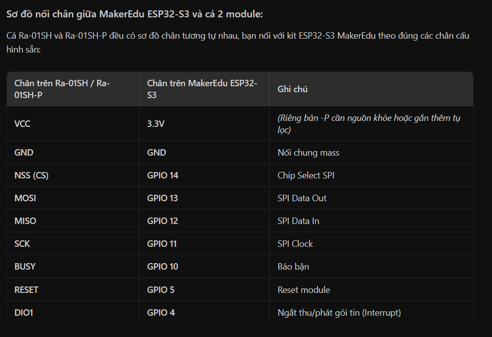
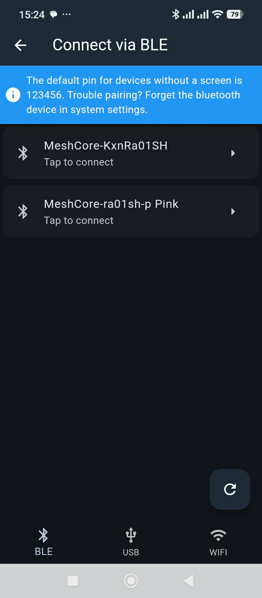
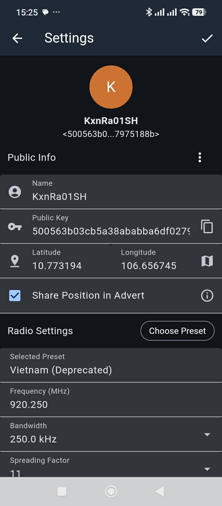

# ks_MeshCore_PlatformIO_v17

## 30/10/2026:

### OK:
- Build và upload firmware mặc định
  - Lora:
    - Chân RESET Lora có thể NC

  - GPS-GP02
    - Chân TXgps -> 48

- Kết quả đạt được:
  - Dùng App Meshcore kết nối Bluetooth 
  - Add Contact dựa vào Public key ở cả 2 bên node
    

    
image

    

    

    
