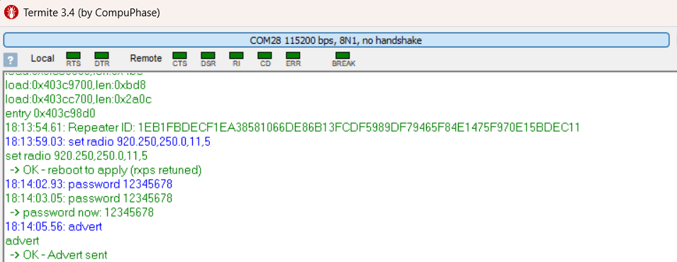
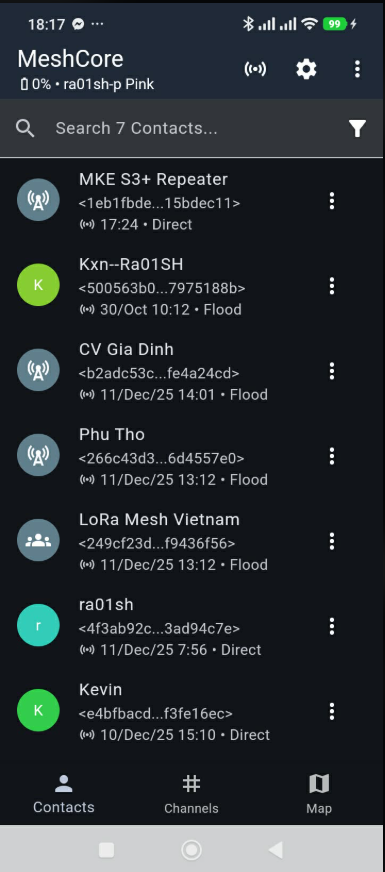
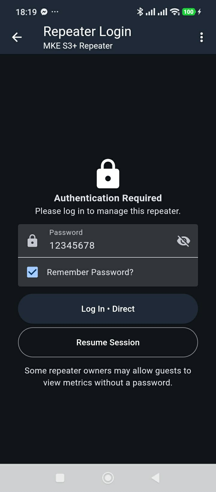
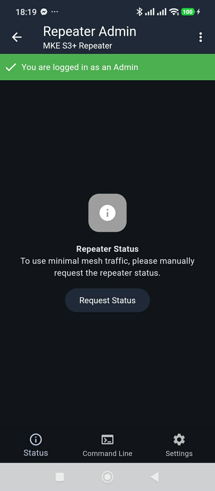
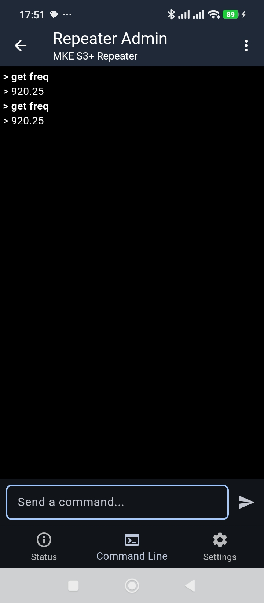

# ks_MeshCore_PlatformIO_v17

## 31/10/2026:

### OK:
  - Create a new Variant MKE_S3_plus:
    - Test `env:MKE_s3_plus_repeater`:
      - Build upload OK
      - setup over USB UART-CH343P OK
        ```
        set radio 920.250,250.0,11,5

        password 12345678

        advert
        ```
        <details>

        
        
        
        
        
        </details>

## 30/10/2026:

### OK:
- Build và upload firmware mặc định cho MKE ESP32-S3-N4 Devkit
  - Lora:
    - Chân RESET Lora có thể NC

  - GPS-GP02
    - Chân TXgps -> 48
  - KXN Add `-D PIN_VBAT_READ=1`VR mô phỏng VBat -> 1 (phần cứng là cầu phân áp 2x100K nối vào chân 1)
    - Đã hiện được mức pin lên Oled
    - Đã hiện được mức pin lên App MeshCore
    - `Sau khi bật PIN_VBAT_READ kết hợp với AUTO_SHUTDOWN_MILLIVOLTS thì hệ thống sẽ shutdown khi Vbat yếu.`


- Kết quả đạt được:
  - Dùng App Meshcore kết nối Bluetooth 
  - Add Contact dựa vào Public key ở cả 2 bên node
    <details>
    <summary>image</summary>

    

    

    </details>